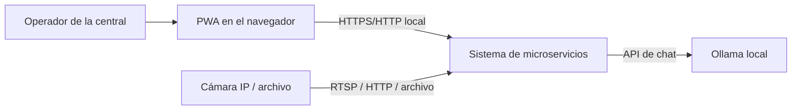
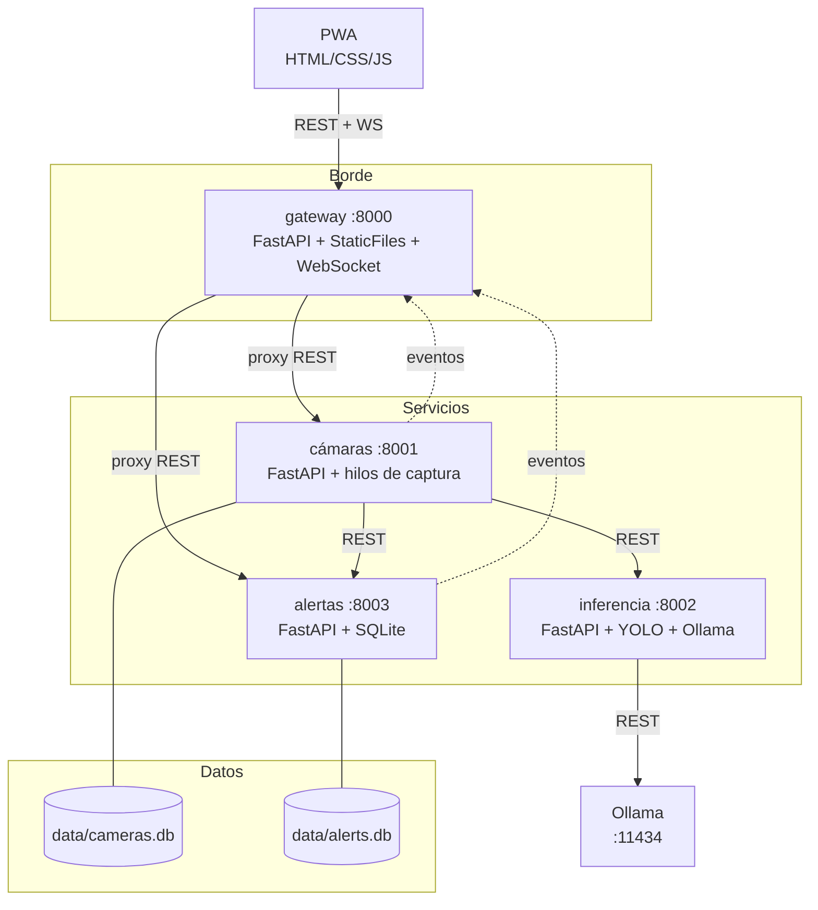
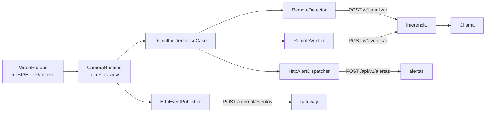
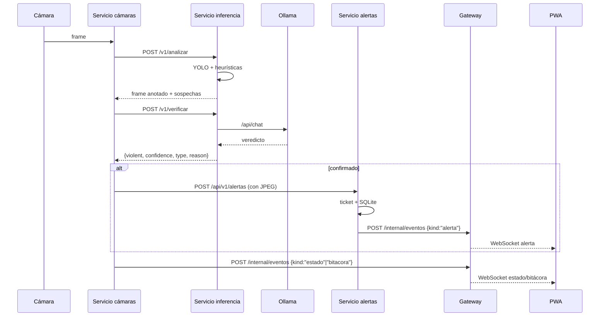
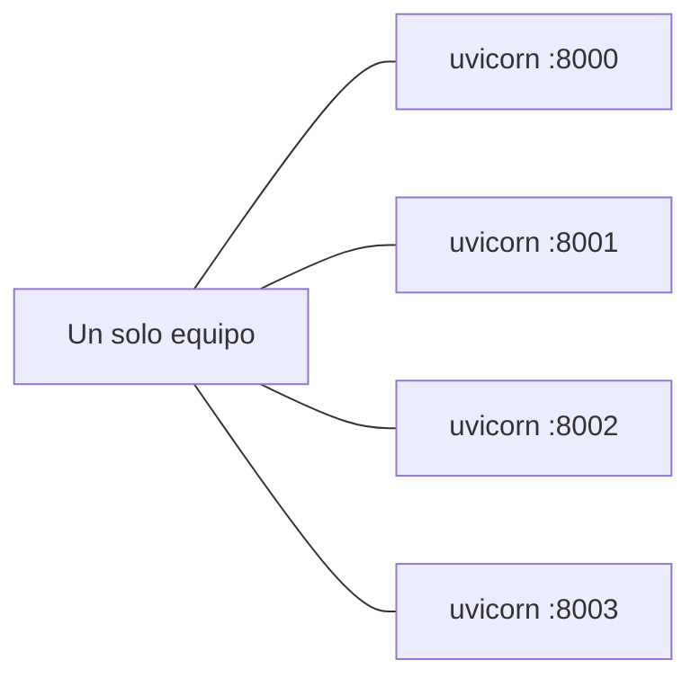
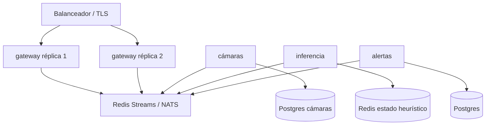

# Arquitectura — Práctica 8

## 1. Contexto

La práctica 7 concentraba en un proceso FastAPI:

- el registro de cámaras y los hilos de captura;
- YOLO y las heurísticas;
- la verificación con Ollama;
- los tickets, la prioridad y la evidencia;
- la PWA, el proxy REST y el WebSocket.

Esa central funcionaba, pero un fallo de inferencia o de la base de alertas
podía afectar a toda la operación, y no había una separación clara de datos.
La práctica 8 parte ese backend en **cuatro servicios desplegables por
separado**, conservando la PWA y el dominio de la práctica anterior.

### Restricciones del entorno

- Windows, Python 3.14, sin Docker.
- Sin Redis, RabbitMQ ni Kafka instalados.
- Ollama y YOLO disponibles localmente.
- Se prioriza una demo reproducible en un solo equipo.

Estas restricciones explican las decisiones de despliegue (procesos uvicorn y
eventos HTTP) y se documentan como tradeoffs, no como arquitectura final.

## 2. Principios

1. **Descomposición por capacidad de negocio.** Gateway/borde, captura,
   inferencia y alertas. No se separó por capas técnicas (un "servicio de
   modelos", otro "servicio de stores").
2. **Propiedad de datos.** Cada servicio escribe su base; nadie más la toca.
   Cámaras es dueño de `cameras.db`; alertas, de `alerts.db`.
3. **Contratos explícitos.** Los modelos Pydantic compartidos definen el
   contrato REST. Los eventos usan un sobre `{kind, data}`.
4. **Aislamiento de fallos.** La caída de un servicio no debe tumbar a los
   demás; cada integración declara si falla abierta o cerrada.
5. **Borde único.** El navegador solo conoce el gateway; los puertos internos
   no se exponen.
6. **La PWA no se reescribe.** El cliente de la práctica 7 se reutiliza; el
   gateway conserva las rutas que ya consumía.

## 3. Vista de contexto



## 4. Vista de contenedores



### Catálogo

| Contenedor | Puerto | Stack | Estado que posee |
|---|---:|---|---|
| gateway | 8000 | FastAPI, httpx, StaticFiles | `EventBus` en memoria y conexiones WebSocket |
| cámaras | 8001 | FastAPI, OpenCV, hilos | Registro en SQLite + runtimes en memoria |
| inferencia | 8002 | FastAPI, Ultralytics, Ollama | Modelo YOLO + heurísticas por cámara |
| alertas | 8003 | FastAPI, SQLite | Tickets y evidencia |

## 5. Pipeline de una cámara

El servicio de cámaras conserva el caso de uso hexagonal de la práctica 7. La
fábrica `build_use_case_factory` construye un caso de uso por cámara con
adaptadores remotos.



- `RemoteDetector` implementa `IncidentDetector`. Si la inferencia falla, marca
  un cooldown de 5 s y devuelve el frame original sin sospechas (**fail-open**).
- `RemoteVerifier` implementa `ViolenceVerifier`. Si la verificación falla,
  devuelve `violent=False` (**fail-closed**).
- `HttpAlertDispatcher` implementa el puerto de salida de alertas y envía la
  captura codificada en base64.
- `CameraRuntime` mantiene el estado, la bitácora y el último frame para la
  preview; no sabe nada de YOLO ni de HTTP.

## 6. Comunicación

### 6.1 Síncrona (REST)

| Origen | Destino | Ruta | Timeout | Fallo |
|---|---|---|---:|---|
| PWA | gateway | `/api/v1/*`, `/ws/eventos` | navegador | La PWA muestra error/reconecta |
| gateway | cámaras | `/api/v1/camaras*` | 30 s (httpx) | 502 al navegador |
| gateway | alertas | `/api/v1/alertas*` | 30 s (httpx) | 502 al navegador |
| cámaras | inferencia | `/v1/analizar` | 8 s | Fail-open + cooldown |
| cámaras | inferencia | `/v1/verificar` | 130 s | Fail-closed |
| cámaras | alertas | `/api/v1/alertas` | 5 s | Se registra y se sigue |
| gateway | servicios | `/health` | 6 s | `status: down` en el agregado |

### 6.2 Eventos

Cámaras y alertas publican en `POST /internal/eventos` del gateway. El gateway
valida un token opcional (`INTERNAL_TOKEN`) y reenvía el sobre a todos los
WebSocket conectados.

```json
{"kind": "estado", "data": {"id": "cam-1a2b3c4d", "state": "en_vivo"}}
```

Tipos:

| `kind` | Emisor | Contenido |
|---|---|---|
| `estado` | cámaras | Ficha de la cámara con `state`, `running`, `last_error` |
| `bitacora` | cámaras | `camera_id`, `camera_name`, `level`, `text`, `at` |
| `alerta` | alertas | `AlertRecord` recién registrado |
| `alerta_actualizada` | alertas | `AlertRecord` con el nuevo estado |
| `hola` | gateway | Versión y conteos al conectar |
| `ping` | gateway | Keepalive cada 20 s |

**Semántica:** *at-most-once*. El publicador usa una cola acotada y un hilo;
si el gateway está caído, el evento se descarta. La PWA se resincroniza por
REST al reconectar. No hay outbox ni replay.

### 6.3 Secuencia de una alerta



## 7. Propiedad de datos

### `cameras.db` (servicio de cámaras)

```sql
camaras(
  id TEXT PRIMARY KEY,
  name TEXT,
  source TEXT,          -- RTSP/HTTP/archivo; se enmascara al salir
  address TEXT,
  lat REAL,
  lon REAL,
  enabled INTEGER,
  created_at TEXT,
  updated_at TEXT
)
```

El estado en vivo no se persiste: lo calcula el supervisor en memoria. La URL
puede contener credenciales; `mask_source` oculta la contraseña antes de
devolverla por la API.

### `alerts.db` (servicio de alertas)

```sql
alertas(
  ticket TEXT PRIMARY KEY,
  client_id TEXT,
  incident_type TEXT,
  confidence REAL,
  status TEXT,
  priority TEXT,
  eta_min INTEGER,
  units_json TEXT,
  received_at TEXT,
  updated_at TEXT,
  payload_json TEXT,    -- AlertRecord sin el base64 de la imagen
  snapshot BLOB,        -- JPEG de evidencia
  snapshot_mime TEXT,
  snapshot_sha256 TEXT,
  has_snapshot INTEGER
)
```

- El ticket es `ALT-YYYYMMDD-NNNN`, secuencial por día.
- La imagen no se duplica en el JSON: se sirve en
  `/api/v1/alertas/{ticket}/captura`.
- SQLite usa WAL y una conexión protegida por lock. Es suficiente para una
  demo de un solo proceso.

## 8. Seguridad

| Borde | Control |
|---|---|
| Navegador → gateway | `CENTRAL_API_KEY` opcional (`X-API-Key` o `?api_key=`) |
| WebSocket | La misma API key en el query string |
| Servicios → gateway | `INTERNAL_TOKEN` opcional en `/internal/eventos` |
| Puertos internos | El stack los ata a `127.0.0.1`; no se publican |
| Credenciales RTSP | Se persisten, pero se enmascaran en las respuestas |
| Evidencia | Se sirve con `Cache-Control: private, max-age=3600` |

**No implementado:** TLS, autenticación servicio-a-servicio, autorización por
rol, rate limiting y cifrado en reposo. En producción, los puertos 8001-8003
deben vivir en una red privada y el gateway debe terminar TLS.

## 9. Despliegue

### Local (esta entrega)



`python -m incidentes.cli.stack` arranca los cuatro procesos, espera los
`/health` y deja el gateway al final. No hay contenedores ni orquestador.

### Producción (evolución)



Cambios necesarios:

- reemplazar `HttpEventPublisher` y el fan-out del gateway por un broker;
- mover el estado heurístico a Redis o usar *sticky sessions*;
- Postgres con migraciones y respaldos;
- outbox en cámaras/alertas para no perder eventos;
- descubrimiento de servicios y configuración centralizada;
- métricas, trazas y *health checks* reales.

## 10. Escalabilidad y consistencia

| Aspecto | Situación actual | Evolución |
|---|---|---|
| Gateway | Un proceso; `EventBus` en memoria | Réplicas + bus compartido |
| Cámaras | Un proceso con hilos por cámara | Varios workers con partición por cámara |
| Inferencia | Un modelo compartido y lock global | Réplicas con GPU; estado por cámara en Redis |
| Alertas | SQLite + lock | Postgres, pool de conexiones, outbox |
| Eventos | HTTP *at-most-once* | Broker con *consumer groups* y replay |
| Consistencia | Cada servicio es dueño de su dato | Sagas/eventos para procesos distribuidos |

El sistema es **eventualmente consistente** entre la captura y el ticket: la
alerta se crea después de la confirmación, y la PWA puede recibir el evento o
resincronizar por REST.

## 11. Salud y arranque

- Cada servicio expone `GET /health` con un campo `status`.
- El gateway agrega los tres health checks; si uno falla, devuelve
  `status: "degradado"` sin dejar de responder.
- El lanzador espera el health de cada backend antes de arrancar el gateway.
  En particular, espera a que YOLO esté cargado y calentado (~20 s en CPU).
- La cámara usa `CAMERAS_AUTOSTART=1` para reanudar las cámaras guardadas.

## 12. Estrategia de pruebas

| Nivel | Qué cubre |
|---|---|
| Dominio/heurísticas | Reglas de sospecha, tipos, persistencia y cooldown |
| Caso de uso | Pipeline con detector/verificador/dispatcher falsos |
| Adaptadores remotos | Parseo, fail-open y fail-closed con `monkeypatch` |
| Supervisor | Arranque, estado, parada y eventos con un caso de uso falso |
| Stores | Tickets secuenciales, estados, evidencia y máscaras |
| APIs | Cámaras y alertas con `TestClient` y stores inyectados |
| Gateway | Evento interno → WebSocket, token y saludo |
| Manual | Stack completo, PWA, snapshot, stream, `/v1/analizar` |

La suite no descarga pesos ni requiere Ollama; las pruebas manuales sí
verifican la integración real.

## 13. Decisiones (ADR resumidas)

| ID | Decisión | Estado |
|---|---|---|
| ADR-01 | Gateway como BFF y único borde | Aceptada |
| ADR-02 | Cuatro servicios por capacidad de negocio | Aceptada |
| ADR-03 | Eventos HTTP al gateway en vez de broker | Aceptada con limitaciones |
| ADR-04 | Base de datos por servicio | Aceptada |
| ADR-05 | Inferencia con estado por cámara y un worker | Aceptada con limitaciones |
| ADR-06 | YOLO compartido con lock global | Aceptada |
| ADR-07 | PWA sin cambios, reutilizada desde la práctica 7 | Aceptada |
| ADR-08 | Fail-open en detección y fail-closed en verificación | Aceptada |

## 14. Riesgos y mitigaciones

| Riesgo | Impacto | Mitigación actual | Mitigación futura |
|---|---|---|---|
| Gateway caído | PWA sin tiempo real | Servicios siguen capturando; REST al reconectar | Réplicas + broker |
| Inferencia caída | Sin detecciones | Fail-open + cooldown; preview sigue | Réplicas y *health checks* |
| Ollama caído | Sin alertas | Fail-closed; no hay falsos positivos | Cola de verificación y reintentos |
| Alertas caídas | Tickets perdidos | Error controlado; captura sigue | Outbox + reintentos |
| Cámara inalcanzable | Sin video | Estado/bitácora y reintento | Alertas de fuente y VPN |
| Estado heurístico perdido | Falsos negativos tras reinicio | Se recalcula con los frames siguientes | Estado en Redis |
| Puertos internos expuestos | Acceso no autorizado | Bind a localhost | Red privada + mTLS |
