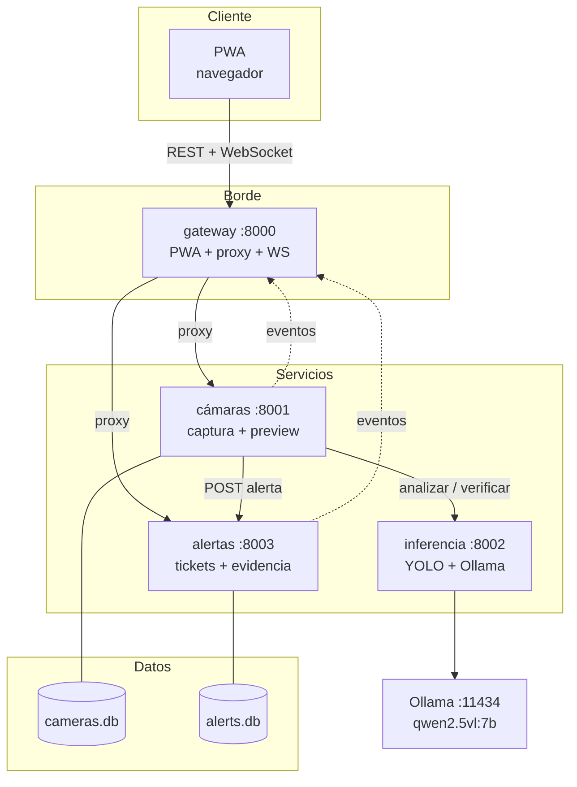

# Práctica 8 — Detección de incidentes con microservicios

## 1. Enunciado y objetivo

La práctica 7 entregó una **PWA instalable** que registraba cámaras, abría su
stream, ejecutaba YOLO + Ollama y mostraba las alertas en tiempo real. Todo el
backend vivía en un único proceso FastAPI.

El objetivo de esta práctica es **dividir ese backend en microservicios**,
manteniendo la PWA como cliente y conservando el comportamiento funcional:

- registrar y operar cámaras;
- obtener una vista previa anotada;
- proponer sospechas con YOLO;
- confirmarlas con un modelo de visión local (Ollama);
- generar tickets con prioridad, ETA y evidencia;
- notificar a la PWA en tiempo real.

No se trata de describir la arquitectura: el repositorio contiene la
implementación ejecutable, las pruebas y la evidencia de funcionamiento.

## 2. Alcance

| Se conserva de la práctica 7 | Se separa en la práctica 8 |
|---|---|
| La PWA (HTML, CSS, JS, manifest y service worker) | Gateway (PWA + proxy + WebSocket) |
| `DetectIncidentsUseCase` y el dominio hexagonal | Servicio de cámaras (captura y heurísticas) |
| `YoloIncidentDetector` y la verificación con Ollama | Servicio de inferencia (YOLO + Ollama) |
| `AlertStore`, tickets, prioridad y evidencia | Servicio de alertas (tickets + evidencia) |
| `CameraSupervisor` y `CameraRuntime` | Servicio de cámaras |
| Contratos REST de cámaras y alertas | Gateway como borde y proxy |

**Fuera de alcance:** Docker, Kubernetes, un broker real (Redis/NATS),
autenticación entre servicios, TLS y alta disponibilidad. El entorno de la
práctica no tiene Docker ni Redis; se implementó una versión local con procesos
y HTTP, documentando qué cambiaría en producción.

## 3. Arquitectura resultante



### Responsabilidades

| Servicio | Puerto | Dueño de | No hace |
|---|---:|---|---|
| gateway | 8000 | La entrada HTTP/WS y el fan-out de eventos | Captura, inferencia ni persistencia de negocio |
| cámaras | 8001 | Registro, hilos de captura, preview y estado de cada cámara | Confirmar incidentes ni persistir tickets |
| inferencia | 8002 | Modelo YOLO, heurísticas por cámara y llamada a Ollama | Capturar video ni guardar alertas |
| alertas | 8003 | Tickets, prioridad/ETA y evidencia | Capturar ni inferir |

Cada servicio tiene su propio proceso, su propia configuración y su propio
ciclo de vida. Solo el gateway está pensado para ser alcanzable por el
navegador.

## 4. Decisiones de diseño

| Decisión | Alternativa descartada | Motivo | Consecuencia |
|---|---|---|---|
| Gateway como BFF | Exponer cada servicio al navegador | Un solo origen, CORS simple, proxy del stream y del WebSocket | El gateway es un punto único de fallo del borde |
| Eventos por HTTP al gateway | Redis/NATS | No hay Docker ni Redis en el entorno | *At-most-once*, sin replay; se puede sustituir el adaptador |
| Un servicio de inferencia | YOLO dentro de cámaras | Aísla CPU/GPU y permite escalar la inferencia aparte | Estado heurístico en memoria; un worker |
| Modelo YOLO compartido | Un modelo por cámara | Menos RAM y carga inicial | Lock global; la inferencia se serializa |
| SQLite por servicio | Una sola base compartida | Propiedad de datos y despliegue independiente | Sin transacciones distribuidas |
| `HttpAlertDispatcher` | Llamada directa al store | Respeta el puerto de salida y el desacoplamiento | Si alertas cae, la alerta se pierde |
| PWA sin cambios | Reescribir la interfaz | El foco es el backend; se conserva la UX validada | La PWA depende del contrato del gateway |

### Por qué no un broker en esta entrega

Un broker habría sido la opción "de manual", pero el entorno no lo soporta y
agregar una dependencia no instalada habría hecho la práctica no reproducible.
Se prefirió un **adaptador HTTP mínimo** (`HttpEventPublisher`) detrás del mismo
puerto `EventPublisher` que usaría un broker. El contrato del evento es
`{kind, data}` y el gateway es el único suscriptor. Cambiar a Redis Streams o
NATS implica reemplazar el adaptador y el fan-out, no el dominio ni la PWA.

## 5. Contratos

### Borde (PWA → gateway)

- `GET /api/v1/camaras`, `POST /api/v1/camaras`,
  `PATCH/DELETE /api/v1/camaras/{id}`.
- `POST /api/v1/camaras/{id}/iniciar|detener`.
- `GET /api/v1/camaras/{id}/snapshot|stream`.
- `GET/POST /api/v1/alertas`, `GET/PATCH /api/v1/alertas/{ticket}` y
  `GET /api/v1/alertas/{ticket}/json|captura`.
- `GET /health`, `GET /api/v1/info`, `WS /ws/eventos`.

### Internos

- **cámaras → inferencia:** `POST /v1/analizar` con
  `{camera_id, image_b64}`; devuelve `annotated_b64`, `incidents` y `alert`.
- **cámaras → inferencia:** `POST /v1/verificar` con
  `{suspicion, image_b64}`; devuelve `{violent, confidence, type, reason, verifier}`.
  El modelo de Ollama se configura en el servicio de inferencia
  (`INCIDENTES_OLLAMA_MODEL`).
- **cámaras → alertas:** `POST /api/v1/alertas` con `AlertIn` (incluye
  `snapshot_b64`).
- **cámaras/alertas → gateway:** `POST /internal/eventos` con `{kind, data}`.
- **gateway → PWA:** WebSocket con `hola`, `estado`, `bitacora`, `alerta`,
  `alerta_actualizada` y `ping`.

El detalle de campos, ejemplos y errores está en [`api.md`](api.md).

## 6. Flujo y modos de fallo

1. La cámara captura un frame y llama a inferencia.
2. Inferencia devuelve el frame anotado y, si hay indicios, una sospecha.
3. El caso de uso verifica la sospecha con Ollama.
4. Si se confirma, envía el ticket y la captura al servicio de alertas.
5. Alertas persiste y publica `alerta` al gateway.
6. El gateway difunde por WebSocket y la PWA actualiza la lista.

| Falla | Comportamiento | Por qué |
|---|---|---|
| Inferencia no responde | `RemoteDetector` es fail-open: no hay sospechas; la cámara sigue y la preview continúa | La disponibilidad de la vigilancia pesa más que una detección |
| Ollama no responde | `RemoteVerifier` es fail-closed: no confirma | Evitar falsos positivos y alarmas sin evidencia |
| Alertas no responde | El dispatcher registra el error; el pipeline no se detiene | Una alerta perdida no debe tumbar la captura |
| Gateway no responde | Los servicios siguen capturando; los eventos se pierden | La PWA se resincroniza por REST al reconectar |
| Cámara RTSP caída | El runtime reintenta y publica `estado`/`bitacora` | Recuperación sin reiniciar el servicio |

## 7. Ejecución local

```bash
python -m venv .venv
.venv\Scripts\activate          # Windows
pip install -e ".[central,dev]"
ollama pull qwen2.5vl:7b

python -m incidentes.cli.stack
```

El lanzador arranca inferencia primero y espera su `/health` (YOLO tarda ~20 s
en cargar y calentar), luego cámaras y alertas, y por último el gateway. La PWA
queda en <http://127.0.0.1:8000>. En otra terminal:

```bash
python -m incidentes.cli.smoke_test
```

Si no hay Ollama, el stack arranca igual: `/health` muestra `ollama: false` y
la preview/detección funcionan, pero no se confirman alertas.

## 8. Evidencia de funcionamiento

### Pruebas automáticas

```text
$ python -m pytest
........................................................................ [ 90%]
........                                                                 [100%]

$ python -m ruff check incidentes tests
All checks passed!
```

- **80 tests**.
- Sin descarga de pesos ni dependencia de Ollama: se usan dobles para detector,
  verificador, publicador y stores.
- Se cubren: dominio y heurísticas, caso de uso, supervisor, store de alertas,
  despacho, API de cámaras, API de alertas, adaptadores remotos, gateway y
  WebSocket.

### Prueba manual del stack

Con los cuatro servicios en marcha:

```text
health: {"status":"ok","gateway":"ok","servicios":{
  "camaras":{"status":"ok","camaras":0,"en_vivo":0},
  "inferencia":{"status":"ok","model":"yolo11n.pt","ollama":false,
                "model_loaded":true,"camaras":0},
  "alertas":{"status":"ok","alertas":0}}}

PWA: 200 · HTML con <title>
alta de cámara: 201 · estado "conectando"
listado: 200 · 1 cámara
snapshot: 200 · JPEG de 6288 bytes
stream: 200 · multipart/x-mixed-replace; boundary=frame
POST /v1/analizar: 200 · frame anotado · 0.4 s (tras calentar YOLO)
baja: 200 · {"removed":"cam-..."}
```

La prueba de pipeline usó un MP4 local como fuente. Ollama no estaba arrancado
en ese entorno; por eso `ollama: false` y no se generaron alertas confirmadas.
La verificación con Ollama es la misma ruta que ya validaba la práctica 7 y se
mantiene cubierta por los tests con dobles.

### Arranque ordenado

`python -m incidentes.cli.stack` espera los `/health` antes de abrir el
gateway. Esto evita que la PWA muestre `inferencia: down` durante los ~20 s de
carga de YOLO, que fue el primer problema observado en la integración.

## 9. Limitaciones y evolución

| Limitación actual | Qué haría en producción |
|---|---|
| Eventos *at-most-once* por HTTP | Redis Streams/NATS + outbox y *consumer groups* |
| Gateway único | Réplicas detrás de un balanceador y un bus compartido |
| Estado heurístico en memoria | Estado en Redis o *sticky sessions* |
| SQLite por servicio | Postgres con migraciones y respaldos |
| Sin TLS ni auth interna | mTLS/JWT, secretos y red privada |
| Sin Docker | Docker Compose/Kubernetes y *health checks* |
| Sin métricas | Prometheus + OpenTelemetry |
| Cámara alcanzable desde la central | VPN/túnel o agente edge |

## 10. Conclusión

La práctica demuestra una separación real de responsabilidades: la captura, la
inferencia, las alertas y el borde tienen procesos, datos y fallos
independientes, y la PWA sigue funcionando como cliente. La entrega es
ejecutable en local con un comando, está probada y documenta explícitamente los
tradeoffs de no usar un broker ni contenedores en este entorno.

## 11. Checklist de entrega

- [x] Cuatro servicios implementados y ejecutables.
- [x] Gateway con PWA, proxy REST, WebSocket y eventos internos.
- [x] Contratos REST y modelos Pydantic.
- [x] Servicio de cámaras con CRUD, captura, preview y snapshot.
- [x] Servicio de inferencia con YOLO compartido y Ollama.
- [x] Servicio de alertas con tickets, prioridad, ETA y evidencia.
- [x] Bases separadas por servicio.
- [x] Modos de fallo documentados y aplicados.
- [x] Arranque local y prueba de humo.
- [x] 80 tests y Ruff limpio.
- [x] README, arquitectura, API y este informe.
